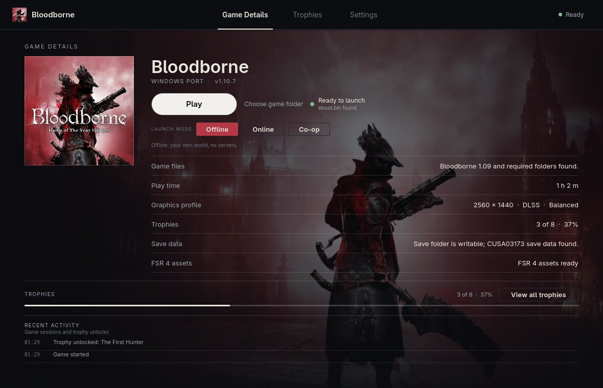
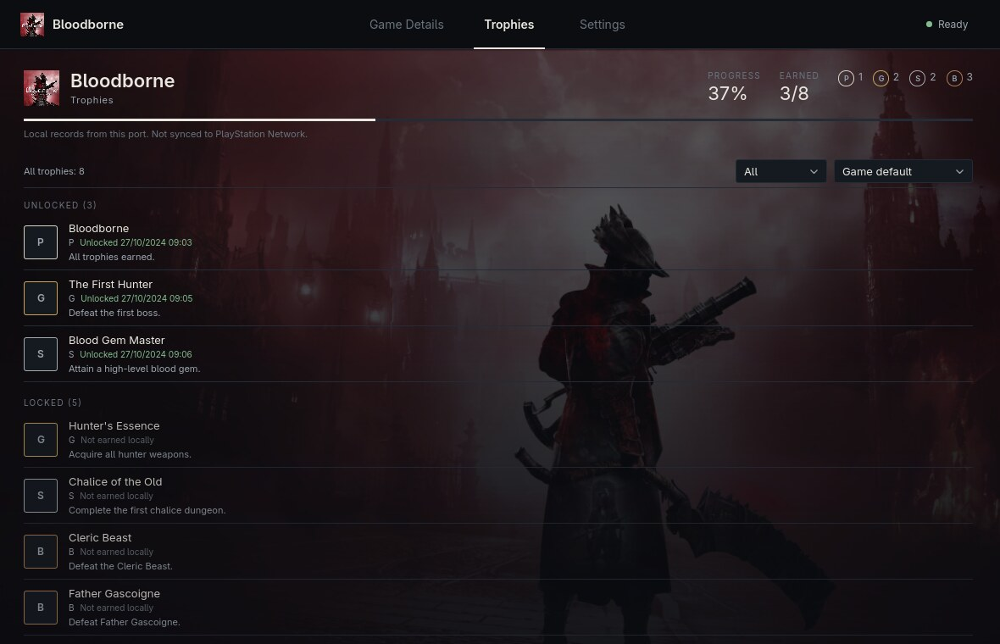
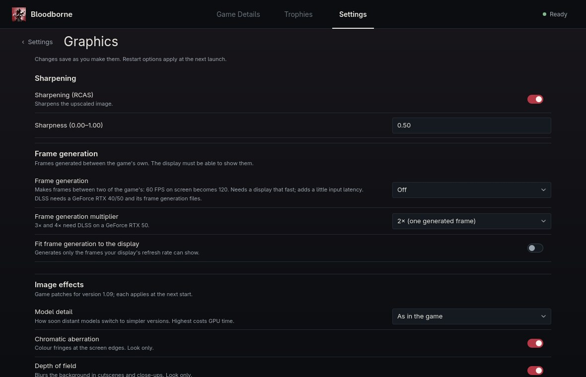

# Windows launcher

The Windows launcher is a PySide6/Qt Quick desktop application in `windows_laucnher/`
(the misspelling is intentional). It configures the game, prepares its files, starts and
stops the game process, and exposes diagnostics. The classic Tk fallback remains available
when Qt Quick cannot start.

The launcher UI is the same shell as the Linux launcher: three destinations — **Game
Details**, **Trophies** and **Settings** — over full-bleed key art, with Settings as a
full-width category list that opens one category at a time. The Windows backend, settings
keys, executable, packaging toolchain, and Windows process model remain compatible with the
existing Windows build.

## Release 1.10.7

Download [bbport-windows.zip](https://github.com/NotBhan/bloodborne-ps2pc/releases/download/v1.10.7/bbport-windows.zip)
from the [release page](https://github.com/NotBhan/bloodborne-ps2pc/releases/tag/v1.10.7).
This build includes trophy details and automatic platinum, Discord Rich Presence on both
platforms, shader precompile controls, and the recorder, motion-vector, cache and shader
pre-build fixes from 1.9.7. See [CHANGELOG.md](CHANGELOG.md) and the
[project README](../README.md).

## Relationship to the Linux launcher

The Linux branch carries a native GTK4/libadwaita launcher. It was built out from the port's
barebones Linux launcher over the later Linux changes and reached feature parity with this
Windows launcher: pages and settings, graphics/upscaler controls, internal-resolution scaling,
mods and patches, the Hunter's Dream account flow, diagnostics, and restart supervision. The
Windows launcher remains maintained here; neither launcher replaces the other, and both share
the renderer, `bbport.ini` settings keys, and preparation scripts.



## Status labels used in this document

- **Implemented** — present in the source tree.
- **Unit-tested** — covered by a test that runs without a window.
- **Build-verified** — a real Windows PE launcher was produced.
- **Launcher-runtime-verified** — the launcher itself ran and was exercised under the
  stated environment.
- **Wine-verified** — the launcher ran under Wine.
- **Proton-verified** — the launcher ran under Steam Proton.
- **Game-launch-verified** — the game process reached its own running code.
- **Gameplay-verified** — a playable session was exercised.
- **Blocked / Failed / Not verified** — no claim is made.

## Destinations

| Destination | Contents |
|---|---|
| **Game Details** | Full-bleed key art, cover mark, launch state, offline/online/co-op mode, primary Play/Stop action, readiness checks, current graphics summary, total play time, trophy progress and recent game/trophy activity. |
| **Trophies** | Local progress, earned/total and grade counts, filter and sort, unlocked and locked sections, unlock dates and descriptions. Unavailable data is reported truthfully. |
| **Settings** | One full-width category list; each category opens on its own with a back breadcrumb. |
| **Setup** | Four-step first-run wizard: welcome, game files, saves/trophies, graphics/finish. |
| **Diagnostics** | A Settings category: process state, last exit code, log line/error/warning counts, runtime report, paths, copy/save/clear log, shader-cache clear, live log with severity colouring and follow mode. |

Settings categories:

| Category | Contents |
|---|---|
| **Display** | Output resolution, HUD position, fullscreen, HDR. |
| **Graphics** | Sharpening, frame generation, image effects, video memory, overlay. |
| **Upscaling** | Upscaler, upscaling preset, live resolution and object-motion vectors, FSR 4 asset download and status. |
| **Performance** | Frame-rate mode, unlocked-mode limit, frames ahead, presentation mode, engine draw pipeline/readbacks/extra environment. |
| **Compatibility** | Developer debug views and validation. |
| **Controller** | Button prompts, mouse, keyboard. |
| **Game & Data** | Game folder, DLC folder, saves folder, trophy keys, language, hunter name, skip-intro, mods and load order, built-in enhancements, Hunter's Atlas, external patches, gameplay patches, The Hunter's Dream sign-in, seamless co-op hosting and joining. |
| **Launcher** | Launcher language, direct-start behavior, desktop/Steam shortcuts, updates from this fork's releases, maintenance. |
| **Diagnostics** | The live log and runtime report described above. |



Every existing field and action from the old category workspace has a home. The shell's
mapping is declared in `launcher/bbport_launcher_backend.py` (`LAUNCHER_CATEGORIES`) and read
by the QML directly; `tests/test_launcher_pages.py` asserts that every settings section is
reachable and that no field appears on two categories (excluding the dedicated Diagnostics
category). The older `LAUNCHER_PAGES` mapping remains for the backend's routing helpers and
their tests.

## Updates

Update checks, the Game Details notice, and **Settings → Launcher → Install update** use
[this fork's releases](https://github.com/NotBhan/bloodborne-ps2pc/releases), never the
upstream Jgamrot package. The installed release tag is tracked separately from `VERSION`, so
the release the build was cut from is not offered as an update.

## Shader precompile

**Settings → Launcher → Engine → Precompile shaders before launch** controls the automatic
pre-build (`BB_SHADER_PREBUILD`). **Settings → Launcher → Maintenance → Precompile shaders**
runs the same warm-up on
demand: the game starts, builds the pipelines the shipped catalog and the player's recorded
cache know, then exits by itself. The game window opens briefly while it runs.

Shaders never recorded yet (a new enemy, effect or area) still compile once, the first time
they are drawn; run the action again after a play session to warm what that session recorded.
The classic Tk launcher keeps both controls on its **Advanced** page.

## Discord Rich Presence

When `companions/Discord Rich Presence/BloodborneRPC.exe` is present, the launcher starts it
with the game. **Settings → Launcher → Engine → Discord Rich Presence** (classic launcher: **Advanced**;
default on, `BB_DISCORD_RPC=0` disables it) controls it. It shows the game name and hunter
level, and switches to **Platinum Trophy Earned** when the platinum trophy is unlocked;
area names, Echoes and Insight are not published. Its settings are in `config.json`
next to the executable and its log is `%LOCALAPPDATA%\bbport-launcher\rpc.log`. The companion
reads the game's memory and the local `trophies.txt` / `trophy_cache/metadata.json` (through
`BB_USER_DIR`, or `user_dir` in `config.json`).

## Trophy keys

Import your own `keys.json` from **Settings → Game & Data → Your data → Import trophy keys** (classic
launcher: **Advanced → Import trophy keys…**). The game reads `<saves>/keys.json`, decrypts
the trophy XML from your game's `trophy00.trp`, and shows names, descriptions, grades and
Gamerscore in **Pause → System → Achievements**. Without a key, the list shows IDs and local
unlock history only. The launcher's readiness row reports whether the pack and key are valid.



## Architecture

- `launcher/qml/Main.qml` — application shell, transparent top bar with the three
  destinations, live status chip, page container, toast notices, and startup routing.
- `launcher/qml/DetailsPage.qml` — Game Details: full-bleed key art, game mark and title,
  Play/Stop, launch mode, information rows, trophy progress, and the game-only activity feed.
- `launcher/qml/TrophiesPage.qml` — trophy progress, filter/sort, and the unlocked/locked
  sections.
- `launcher/qml/Ps5Settings.qml` — the Settings category menu and category detail view. The
  category and group map comes from the backend (`launcher.settingsCategories`).
- `launcher/qml/SectionActions.qml` — the actions that belong to a section (install,
  sign-in, co-op, mods, maintenance, and so on).
- `launcher/qml/DiagnosticsPage.qml` — live process/runtime/path/log view, shown inside the
  Settings → Diagnostics category.
- `launcher/qml/SetupWizard.qml`, `Splash.qml` — first-run setup and the direct-launch
  splash.
- `launcher/qml/Glass*.qml`, `FieldRow.qml`, `ToggleRow.qml`, `Note.qml`, `NavIcon.qml`,
  `Theme.qml` — shared controls and design tokens. The historical filenames are retained to
  keep the change focused; the controls are flat surfaces, not glass.

Process ownership stays in `bbport_launcher_backend.py`. Page visibility and window state
never decide whether an operation completes. The backend exposes:

- `launchState` (`ready`, `starting`, `running`, `preparing`, `failed`)
- `lastExitCode`
- `runtimeInfo` (`gpu`, `upscaler`, `objectMotion`, `presentMode`, `output`, `error`)
- `logStats`, `logLines`, and `paths`
- `settingsCategories`, `sectionFields(category, section)`, `sectionHint(category, section)`
- `pageSections(page)` / `pageFor(category, section)` (routing helpers used by tests)
- `action("openLogs")` and `action("exportLog")` alongside the existing copy/clear actions

Settings still go through the existing validated, atomic-write path. Unknown settings keys
are preserved, malformed files fall back safely, and the QML controls do not write directly
to disk.

Destination and category changes are plain `visible` bindings in `Main.qml` and
`Ps5Settings.qml`. There are no page-transition animations, repaint timers, sleeps, page
recreation loops, or fullscreen toggles.

## Wine page-transition fix

The Wine-specific rendering fix is unchanged and is required for the new shell:

- `launcher/bbport_launcher_win.py` detects Wine/Proton and sets
  `QSG_RHI_BACKEND=opengl` only when the user has not chosen a backend.
- `launcher/bbport_launcher_qml.py` applies the same configuration before importing
  PySide6.
- Native Windows keeps Qt's default Direct3D 11 backend.

Root cause and regression procedure: [WINE_LAUNCHER_RENDERING.md](WINE_LAUNCHER_RENDERING.md).

## Build

### Full package

Follow [packaging/windows/README.md](../packaging/windows/README.md). From an MSYS2
**CLANG64** shell:

```bash
bash build.sh
bash packaging/windows/package.sh
```

`package.sh` freezes the launcher with PyInstaller, collects `bb-probe.exe` and its
CLANG64 DLLs, and assembles `dist/bbport-windows/`. This machine has no MSYS2 CLANG64
sysroot, so the native runtime could not be rebuilt here.

### Launcher-only build used for this task

A genuine Windows launcher was frozen under Wine with Windows Python 3.12.10,
PyInstaller 6.22.3, and PySide6 6.12.0:

```bash
WINEPREFIX=... wine 'C:\bbport-python\python.exe' -m PyInstaller \
  --noconfirm --clean --windowed --name Bloodborne \
  --icon launcher/assets/hunter-icon.ico \
  --distpath out/wine/pyi-dist --workpath out/wine/pyi-work \
  --paths scripts --paths launcher \
  launcher/bbport_launcher_win.py
```

The package was assembled under `out/wine/package/bbport-windows/` with the frozen
`Bloodborne.exe`, `_internal/`, QML files, assets, `run.py`, and scripts. The executable is
a real Windows PE32+ GUI binary:

```text
PE32+ executable for MS Windows 6.00 (GUI), x86-64
SHA-256 4dbd863e40545f26bc5b8c3a1fb37f1b308e679c3eaaa0a3b78af40772a472b6
```

The launcher-only package intentionally has an empty `bin/`; it cannot start the game
without a native `bb-probe.exe`. Build artifacts under `out/` are not committed.

## Tests

```bash
python -m unittest discover -s tests
python -m unittest tests.test_launcher_pages -v
```

Observed on this machine:

- 466 tests: **OK, 77 skipped**. The page-mapping module (now eight tests, including the
  category coverage and one-owner-per-field checks) passes.
- Windows launcher settings tests: **23 passed**.
- Renderer selection tests: **4 passed**.

The suite has no failures on this Linux host in the current tree; earlier notes about
`test_hunters_dream` and a mods-path test were fixed or are skipped here.

## Wine verification

Environment used for the packaged launcher check:

- Wine 11.18 (Staging), 64-bit prefix.
- Windows Python 3.12.10, PySide6 6.12.0, PyInstaller 6.22.3.
- Xvfb `:99`, 1600x1000, **no window manager**, OpenGL Qt Quick RHI.
- Package: `out/wine/package/bbport-windows/Bloodborne.exe --launcher`.

Observed on the earlier page set:

- The packaged window appeared at 1360x860 and rendered frames 1–2.
- Navigation between the old pages produced the new page and a following present frame each
  time (for example `QML page=Graphics` followed by `frame 3 page='Graphics'`).
- No QML warnings or `ReferenceError`s were logged; the Setup page opened.
- No resize or fullscreen toggle was used.
- `QSG_RHI_BACKEND=d3d11` remains the control experiment for the old stall.

The current three-destination shell was exercised separately on this machine through Qt's
offscreen platform at 1180x760 and at the 900x600 minimum: Game Details, Trophies, the
Settings category menu, Graphics, Upscaling, Diagnostics and the setup wizard all rendered
with real fixture data, no QML warnings and no clipped controls. `qmllint` is clean for the
shell and its pages, and `Settings → Diagnostics` still hosts the live log.

This is **launcher-runtime-verified** and **Wine-verified** for the earlier shell. Windowed
mode at the default size was exercised there; maximized/fullscreen were not. The new shell
declares a 900x600 minimum and was exercised at that size through the offscreen platform. A
Wine re-run of the new shell, native Windows, and Proton were not verified in this session.

### Game launch attempt

An isolated copy of the package was given the user's existing `bin/` (the prebuilt older
`bb-probe.exe` and DLLs) and started from the new launcher. The launcher prepared files,
started Vulkan, and reached GPU initialization. The existing runtime then failed at
`ErrorSurfaceLostKHR` in `vk_swapchain.cpp:227` under the headless Xvfb/Wine display.

This is **not** a successful game-launch verification and **not** a launcher failure. It is
an environment/runtime limitation; the same prebuilt binary also reports
`Unknown present mode FifoRelaxed` because it predates the ported runtime changes. A
native runtime built with MSYS2 CLANG64 is still required to verify the current FIFO
Relaxed/upscaler code. Gameplay was not exercised.

## Proton

Proton 11.0 starts the classic Tk fallback launcher. The Qt Quick path is blocked before
the renderer selection applies: Proton's Wine ICU 68 does not provide the unversioned
`icuuc.dll`/`icuin.dll` that Qt 6.12 imports. This is separate from the D3D11 present bug
and was not changed in this task. No global Proton, Wine, compositor, or system
configuration was modified.

## Diagnostics and environment

- Settings: `%APPDATA%\bbport-launcher\settings.json`; legacy game settings:
  `bbport.ini` in the port/data directory.
- `BB_CONFIG` overrides the settings path; `BB_DATA_DIR` overrides the data directory.
- `BB_LAUNCHER_DEBUG=1` writes launcher/page/window/frame and Qt/QML warnings to
  `%APPDATA%\bbport-launcher\launcher-debug.log`. It is off by default and no per-frame
  logging occurs without it.
- `QSG_RHI_BACKEND` / `QT_QUICK_BACKEND` explicitly chosen by the user are never
  overridden.
- The Diagnostics page shows the port, saves, run-log, and config paths. Use **Copy log**
  or **Save log…** when collecting a report; the session log is capped in the UI at the
  most recent 4000 lines while the copied/exported log remains the full session buffer.

## Known limitations

- The launcher-only test package contains no native runtime.
- Native `bb-probe.exe` from this branch could not be rebuilt on this host.
- The prebuilt older runtime cannot verify the ported `FifoRelaxed` and active-upscaler
  runtime changes.
- Game launch under the headless test display failed at Vulkan surface creation.
- Maximized/fullscreen, native Windows, and Proton Qt Quick were not verified.
- The screenshots in this document are from the Wine/Xvfb test, not from native Windows.
